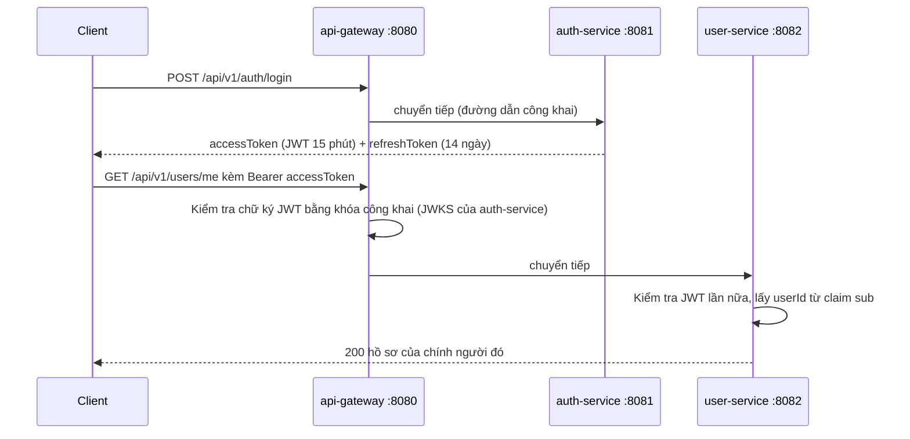

# Bảo mật qua gateway (tuần 3)

Mô tả luồng xác thực từ client tới service, và những gì đã được bảo vệ.

## Luồng

## Ai kiểm tra gì

| Lớp | Việc | Vì sao |
|---|---|---|
| api-gateway | Kiểm tra JWT, chỉ cho phép `/api/v1/auth/**`, `/api/v1/search/**`, `/api/v1/webhooks/**` không cần token | Chặn sớm request không hợp lệ |
| Từng service | Kiểm tra JWT lần nữa | Không tin gateway tuyệt đối: nếu một service lộ cổng ra ngoài thì vẫn không vào được |
| Controller | `userId` lấy từ `sub` của JWT, không nhận từ client | Người dùng không thể xem hồ sơ của người khác bằng cách đổi tham số |

## Vòng đời token

| Token | Hạn | Lưu ở đâu | Ghi chú |
|---|---|---|---|
| Access token (JWT RS256) | 15 phút | Không lưu | Service kiểm tra bằng chữ ký, không gọi về auth-service |
| Refresh token (chuỗi ngẫu nhiên 43 ký tự) | 14 ngày | **Chỉ lưu băm SHA-256** trong bảng `refresh_token` | Dùng được **một lần**; mỗi lần làm mới sinh token mới |

**Phát hiện đánh cắp:** nếu một refresh token đã dùng rồi mà lại xuất hiện lần nữa, hệ thống coi như bị đánh cắp và thu hồi **toàn bộ** refresh token của người dùng đó (đăng nhập lại là xong).

## Chống đoán mật khẩu

- Đếm số lần đăng nhập sai trong Redis, theo **email** (tối đa 5 lần) và theo **IP** (tối đa 20 lần), trong 15 phút.
- Quá giới hạn: trả `429` kèm header `Retry-After`. Lúc này kể cả nhập đúng mật khẩu cũng bị chặn cho đến khi hết hạn khóa.
- Đăng nhập đúng thì bộ đếm theo email về 0.
- Email được băm trước khi làm khóa Redis.

## Giới hạn đã biết (cố ý chấp nhận ở tuần 3)

1. **Khóa theo email có thể bị lợi dụng:** kẻ xấu cố tình đăng nhập sai 5 lần với email của bạn có thể khóa bạn 15 phút. Bộ đếm theo IP và thời gian khóa ngắn giảm tác hại; sau này có thể thêm CAPTCHA.
2. **IP thật của client:** auth-service đặt `server.forward-headers-strategy=native` để đọc `X-Forwarded-For` từ gateway. Nếu gateway không chuyển header này, mọi request trông như đến từ IP của gateway và bộ đếm theo IP bị dùng chung cho tất cả. Hãy kiểm tra ở bước thử qua gateway.
3. **Claim `roles` chưa thành quyền hạn:** token có `roles` nhưng các service chưa ánh xạ thành `ROLE_*`. Việc này làm ở tuần 4 khi property-service cần phân quyền host.
4. **Chưa có thu hồi access token:** access token còn hiệu lực đến hết 15 phút dù đã đăng xuất. Đây là đánh đổi tiêu chuẩn của JWT.
5. **Endpoint `/actuator/prometheus` đang công khai** để Prometheus lấy số liệu. Production phải chặn ở tầng mạng.